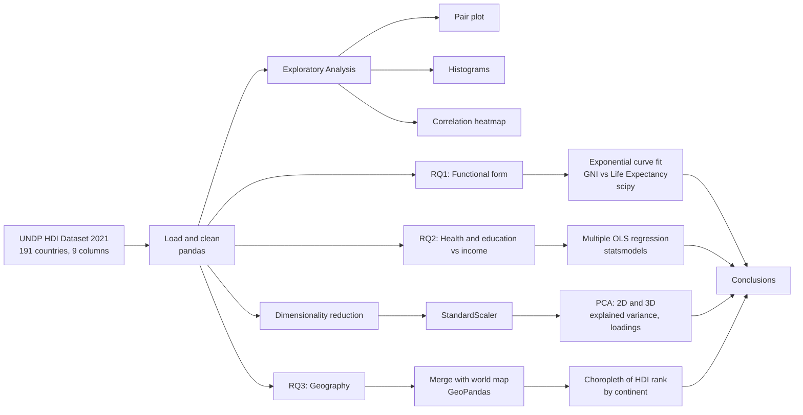
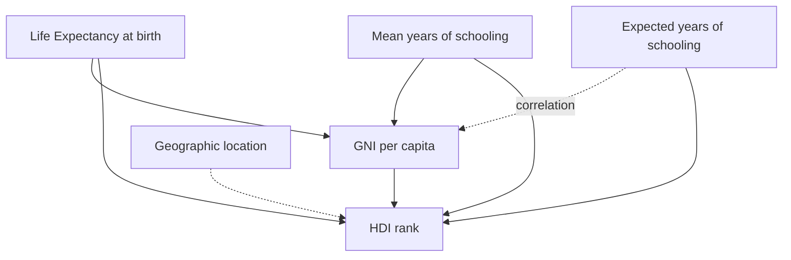

# The Puzzle of Economic Development


An economic data analysis of whether Human Development Index (HDI) indicators, health and education, explain a country's Gross National Income (GNI) per capita, and whether geography shapes development. The analysis covers 191 countries using UNDP data for 2021.

**Published paper:** Singh, R. (2024). *The Puzzle of Economic Development.* International Journal of Humanities Social Science and Management (IJHSSM), 4(6), 252–259. [DOI: 10.5281/zenodo.23866917](https://doi.org/10.5281/zenodo.23866917)

---

## Key Findings

- **Life expectancy and schooling predict income.** Together they explain **56.9%** of the variation in GNI per capita (R² = 0.569, F = 124.1, p < 0.001).
  - +1 year of life expectancy → about **+$1,588** GNI per capita
  - +1 mean year of schooling → about **+$1,719** GNI per capita
- **The relationship is non-linear.** GNI per capita rises exponentially with life expectancy.
- **One dimension dominates.** PCA shows PC1 alone captures **79.1%** of the variance, and PC1 + PC2 together capture **89.0%**.
- **Geography matters.** Countries with lower development cluster in Africa and parts of Central Asia, while Europe, North America and Oceania score mostly high.

---

## Project Pipeline



## Conceptual Model



---

## Research Questions

1. What is the functional form of the relationship between GNI per capita and life expectancy at birth?
2. Is there a relationship between health and education indicators and the GNI per capita of nations?
3. Is a nation's HDI affected by its geographical location?

---

## Dataset

**Source:** [UNDP Human Development Reports: Human Development Index data center](https://hdr.undp.org/data-center/human-development-index#/indicies/HDI), year 2021.

| Column | Description |
|---|---|
| `HDI_rank` | Country's HDI rank (1 = highest) |
| `Country` | Country name |
| `HDI` | Human Development Index score (0–1) |
| `LE` | Life expectancy at birth (years) |
| `Expected_years_of_schooling` | Expected years of schooling |
| `Mean_years_of_schooling` | Mean years of schooling |
| `GNI_per_capita` | Gross National Income per capita |
| `GNI per capita rank minus HDI rank` | Gap between income rank and HDI rank |
| `HDI_rank_2020` | HDI rank in the previous year |

---

## Results

### Multiple OLS Regression: GNI per capita

n = 191, R² = 0.569, Adj. R² = 0.564, F = 124.1, Prob(F) = 4.33e-35

| Variable | Coefficient | Std. error | t | p-value |
|---|---|---|---|---|
| Constant | -106,900 | 11,600 | -9.25 | < 0.001 |
| Life expectancy (LE) | 1,588.13 | 200.46 | 7.92 | < 0.001 |
| Mean years of schooling | 1,719.01 | 488.35 | 3.52 | 0.001 |

### Correlation with GNI per capita

| Indicator | Correlation |
|---|---|
| Life expectancy | +0.79 |
| Expected years of schooling | +0.77 |
| Mean years of schooling | +0.73 |
| HDI rank | -0.79 |

*A negative correlation with HDI rank means richer countries have better (lower-numbered) ranks.*

### Principal Component Analysis

| Component | Variance explained | Cumulative |
|---|---|---|
| PC1 | 79.08% | 79.08% |
| PC2 | 9.92% | 89.00% |

All indicators load positively on PC1, which acts as an overall development score. On PC2, GNI per capita loads positively while schooling loads negatively, which separates income from education.

---

## Tech Stack

| Task | Library |
|---|---|
| Data handling | pandas, NumPy |
| Regression | statsmodels |
| Curve fitting | SciPy (`curve_fit`) |
| PCA and scaling | scikit-learn |
| Visualisation | matplotlib, seaborn |
| Maps | GeoPandas |

---

## Repository Structure

```
.
├── paper.pdf               # Published paper (IJHSSM, 2024)
├── hdi_analysis.ipynb      # Full analysis notebook
├── HDI_1.csv               # UNDP HDI dataset (2021)
└── README.md
```

---

## How to Run

```bash
# 1. Clone the repo
git clone <repo-url>
cd <repo-folder>

# 2. Install dependencies
pip install pandas numpy scipy statsmodels scikit-learn matplotlib seaborn geopandas jupyter

# 3. Open the notebook
jupyter notebook hdi_analysis.ipynb
```

> **Notes**
> - The notebook loads the CSV from a local Windows path. Update `file_path` in the first cell to point to `HDI_1.csv` in this repo.
> - The world map cells use `gpd.datasets.get_path('naturalearth_lowres')`, which was removed in GeoPandas 1.0. Use `geopandas<1.0`, or download the [Natural Earth 110m countries](https://www.naturalearthdata.com/downloads/110m-cultural-vectors/) shapefile and load it with `gpd.read_file()`.

---

## Limitations

- **Single year (2021):** a cross-sectional snapshot, so causal effects cannot be established.
- **Correlation, not causation:** income may drive health and education as much as the reverse.
- **Geography finding is visual:** the link with location comes from map inspection, not a formal statistical test.
- **Omitted factors:** institutions, inequality, trade and natural resources are not included.

---

## Citation

```bibtex
@article{singh2024development,
  author  = {Singh, Rimjhim},
  title   = {The Puzzle of Economic Development},
  journal = {International Journal of Humanities Social Science and Management},
  volume  = {4},
  number  = {6},
  pages   = {252--259},
  year    = {2024},
  doi     = {10.5281/zenodo.23866917}
}
```

## Author

**Rimjhim (Rémy) Singh**, MSc Behavioural and Data Science, University of Warwick

## Data Credit

Human Development Index data: United Nations Development Programme (UNDP), Human Development Report Office.
